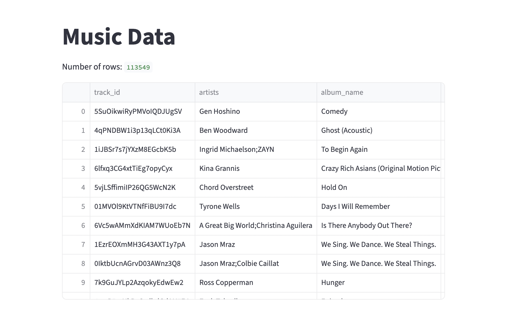
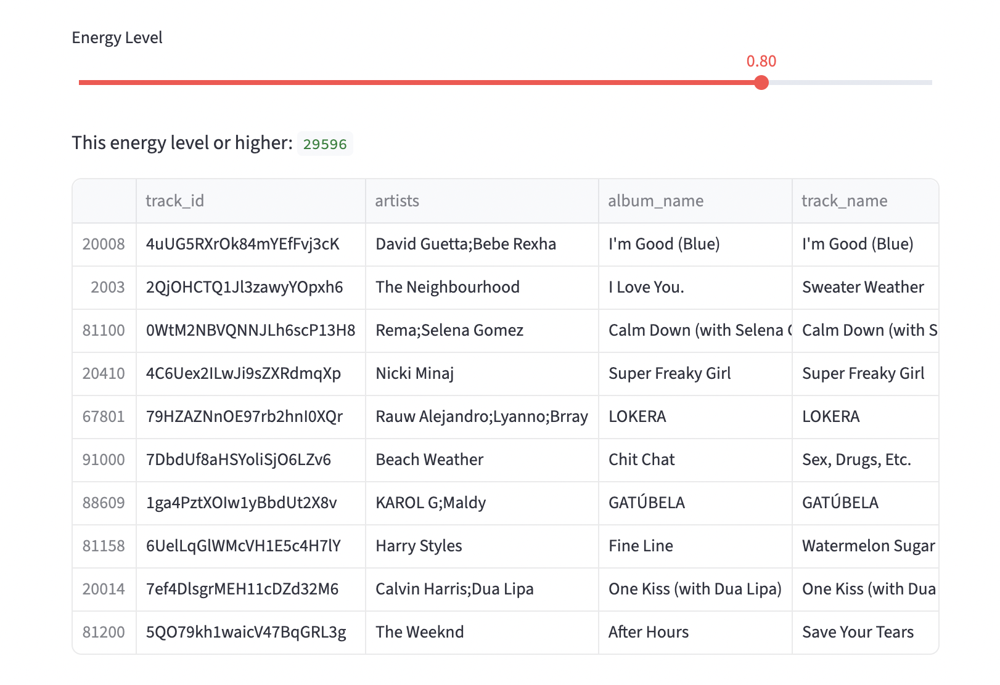
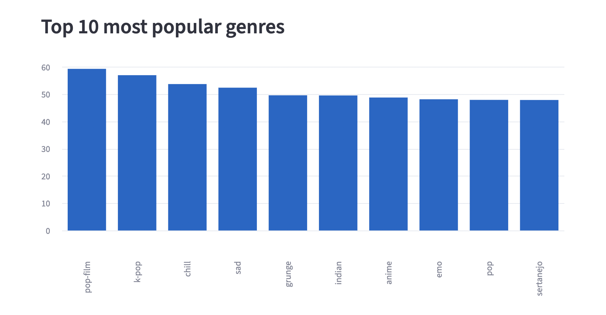
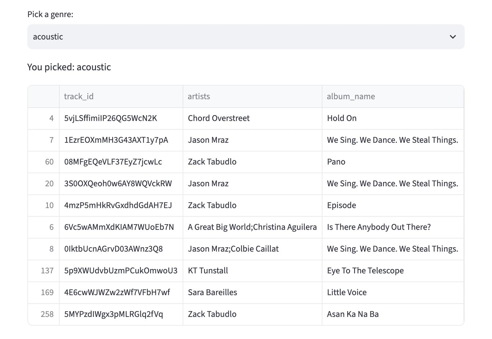

# Music Data Explorer
Have you ever wondered which genres are the most popular, or couldn't find a song that matches your mood? This app explores a Spotify dataset of 114,000 songs across 114 genres. Pick a genre to see its top songs, or choose an energy level to find popular songs that match it.

**Coming soon:** upload your own YouTube or Spotify history and see your personal stats.

Live app: https://td-music-data.streamlit.app

## Features
- Pick a genre and see its 10 most popular songs
- Bar chart of the 10 most popular genres
- Energy slider to find popular songs that match your mood

## Screenshots





## What I found
- The most popular genre is Pop-film with average popularity of 59.3 out of 100 
- The fastest genre by tempo is drum and bass with about 155BPM, followed by happy (153BPM) and hard style (147BPM)
- Happy genre scores less than sad genre in valence with 0.33 and 0.42, respectively

## How to run it
```
git clone https://github.com/tiaradoan/music-python-project.git
cd music-python-project
python3 -m venv venv
source venv/bin/activate
pip install -r requirements.txt
streamlit run app.py
```

## Built with 
- Python
- Pandas
- Streamlit
- Data source: Spotify Tracks Dataset from Kaggle

## What I learned 
- Clean up, gather and analyze data using Pandas
- Building a web app with Streamlit
- Using Git and deploying